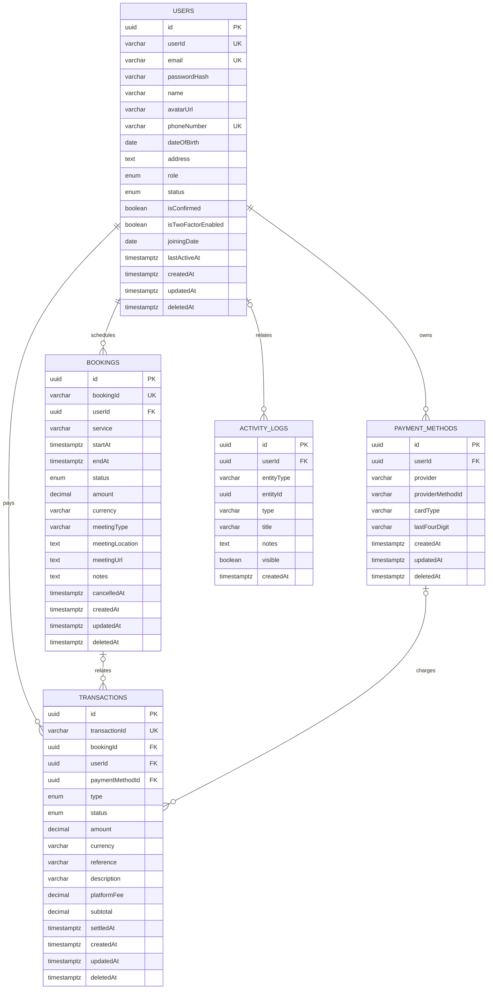

# AdminHub API

## Requirements

- Node.js 20 or newer
- PostgreSQL 16 or newer
- Redis 7 or newer

## Setup

```powershell
npm install
npm run db:migrate
npm run db:seed
npm run start:dev
```

## Environment variables

Create a `.env` file in the project root:

```env
DB_HOST=
DB_PORT=
DB_USERNAME=
DB_PASSWORD=
DB_DATABASE=

JWT_SECRET=
JWT_EXPIRES_IN_SECONDS=

REDIS_URL=
REDIS_TOKEN=

BACKEND_PORT=
HOST=
NODE_ENV=

ADMIN_NAME=Admin
ADMIN_EMAIL=admin@gmail.com
ADMIN_PASSWORD=Admin@123
```

`ADMIN_EMAIL` and `ADMIN_PASSWORD` are used by `npm run db:seed`. Environment
values override the seed defaults.

## Admin credentials

The default seeded administrator is:

- Email: `admin@gmail.com`
- Password: `Admin@123`

Change these credentials before using the application outside local
development.

## Database schema



### Indexes

```text
users:
  (createdAt, status) WHERE deletedAt IS NULL

bookings:
  (createdAt, status) WHERE deletedAt IS NULL
  (userId)

transactions:
  (createdAt, status, type, currency, amount) WHERE deletedAt IS NULL
  (createdAt, currency, amount) WHERE deletedAt IS NULL AND status = 'completed' AND type = 'payment'
  (userId)
  (bookingId)

activity_logs:
  (entityType, entityId)
  (userId, visible)
```

These indexes support dashboard calculations and the filters used by the application. No indexes are added solely for sorting.
